# NeuroStack-3D: Architectural Blueprint for a Biomimetic 3D Neuromorphic Processor

**Author / Role:** Lead Neuromorphic Hardware Engineer & Silicon Architect  
**Classification:** Conceptual 3D-IC Neuromorphic Systems Design  
**Target Application:** Ultra-low-power edge sensory processing, brain-scale Spiking Neural Networks (SNNs), and in-memory event-driven computing.

---

## Executive Summary & Cortical Mapping

Traditional von Neumann architectures suffer from the "memory wall" — the physical separation and bus bottleneck between memory and logic. In contrast, the mammalian cerebral cortex integrates dendritic computation, synaptic weight storage, somatic integration, and axonal routing within a dense, multi-laminar vertical column (~2 mm thick across 6 cortical layers).

`NeuroStack-3D` translates the biological six-layer neocortex into a vertically integrated, heterogeneous **3D Integrated Circuit (3D-IC)**. By separating functional modalities into dedicated tiers interconnected via sub-micron vertical bonding and Through-Silicon Vias (TSVs), the architecture achieves:
- **Massive In-Memory Parallelism:** Synaptic crossbars directly stacked above soma circuits eliminate planar wire delays.
- **Ultra-Low Energy Per Synaptic Event:** Event-driven, subthreshold analog computing targeting $< 50\,\text{fJ}$ per synaptic operation (SOP).
- **Bio-Realistic Spatial Density:** Crossbar memory densities reaching $> 10^{10}\,\text{synapses/cm}^2$.

---

## 1. Vertical Layer Stacking & Tier Partitioning

The architecture mimics biological laminar structures by segregating sensing, synaptic matrixing, soma integration, and long-range routing into four functional silicon and back-end-of-line (BEOL) tiers, topped by an active cooling and power delivery network.

```mermaid
flowchart TD
    subgraph Packaging ["3D Heterogeneous Packaging"]
        T0["Tier 0: Event Transduction & Sensor Front-End (DVS Retinomorphic / Sensory Core)"]
        HB01["Hybrid Cu-Cu Bonding (1.0 µm pitch)"]
        T1["Tier 1: Synaptic Weight Matrix (3D Dual-Deck BEOL Memristive Crossbars)"]
        MIV["Monolithic Inter-tier Vias (MIVs / Sub-micron Direct Contacts)"]
        T2["Tier 2: Soma & Dendritic Integration Tier (Subthreshold CMOS LIF Engines)"]
        TSV23["High-Density Through-Silicon Vias (TSVs / 2.5 µm pitch)"]
        T3["Tier 3: Axonal Routing & Asynchronous NoC (3D-AER Packet Switchers)"]
        BPDN["Backside Power Delivery Network (BS-PDN) & Microfluidic Cold Plate"]
    end

    T0 --> HB01
    HB01 --> T1
    T1 --> MIV
    MIV --> T2
    T2 --> TSV23
    TSV23 --> T3
    T3 --> BPDN
```



### Detailed Tier Breakdown

| Tier | Function | Silicon / Process Technology | Biological Analogy | Key Components |
| :--- | :--- | :--- | :--- | :--- |
| **Tier 0** | **Sensory Transduction** | 45nm CIS (CMOS Image Sensor) process, Backside Illuminated (BSI) | Retinal Ganglion / Sensory Receptors | Event-based Dynamic Vision Sensor (DVS) pixels, temporal contrast detectors, asynchronous log-domain amplifiers. |
| **Tier 1** | **Synaptic Memory Matrix** | BEOL (Back-End-of-Line) embedded RRAM/PCM integrated into metal layers M5–M8 | Cortical Layers II/III & IV (Intra-column Synapses) | 1S1R (One-Selector, One-Resistor) 3D crossbar arrays. Conductance ($G$) represents synaptic strength. |
| **Tier 2** | **Soma / Integration Logic** | 16nm / 7nm FinFET or FD-SOI (Low-Leakage Subthreshold CMOS) | Cortical Layer V (Pyramidal Neurons / Soma) | Leaky Integrate-and-Fire (LIF) analog soma circuits, membrane capacitance ($C_{\text{mem}}$), threshold comparators, reset switches. |
| **Tier 3** | **Axonal Interconnect / Routing** | 7nm High-Performance Standard Cell CMOS | Cortical Layer VI & White Matter Tracts (Axon Bundles) | 3D Asynchronous Address-Event Representation (AER) routers, packet decoders, cross-tile broadcast arbiters. |
| **Base** | **Backside PDN & Thermal Substrate** | Thinned Si substrate with Backside Buried Power Rails (BPR) + Micro-cooling | Cerebral Vasculature (Blood Flow & Cooling) | Backside power distribution to reduce IR drop, structural carrier, integrated microfluidic micro-channels. |

---

## 2. 3D Interconnect Technologies & Signalling Architecture

Vertical communication across the stack is partitioned into two distinct physical hierarchies: **ultra-dense analog neural coupling** (Soma $\leftrightarrow$ Synapse) and **packetized digital axon routing** (Tile $\leftrightarrow$ Tile / Inter-Column).

```
   +--------------------------------------------------------------+
   |  Tier 0: DVS Sensor Layer (Event Generation: x, y, polarity) |
   +--------------------------------------------------------------+
           | | | | (Hybrid Cu-Cu Bonding @ 1.0 µm pitch)
   +--------------------------------------------------------------+
   |  Tier 1: Synaptic Crossbar Array (BEOL Memristors: 1S1R)     |
   |          [Wordlines / Bitlines crossbar grid]                |
   +--------------------------------------------------------------+
           | | | | (Monolithic Inter-tier Vias / MIVs @ 100 nm)
   +--------------------------------------------------------------+
   |  Tier 2: Soma Integration (Analog LIF Neurons, Cm, I_leak)  |
   +--------------------------------------------------------------+
           | | | | (Through-Silicon Vias / TSVs @ 2.5 - 5.0 µm)
   +--------------------------------------------------------------+
   |  Tier 3: Axon / 3D-AER Router (Asynchronous Packet Mesh NoC) |
   +--------------------------------------------------------------+
           | | | | (Backside Vias to Power Rails)
   +--------------------------------------------------------------+
   |  Tier 4: Backside PDN & Microfluidic Heat Sink               |
   +--------------------------------------------------------------+
```

### 2.1 Physical Interconnect Modalities

1. **Monolithic 3D Inter-tier Vias (MIVs):**
   - **Locations:** Between Tier 1 (Synaptic Crossbars) and Tier 2 (Soma Integration).
   - **Dimensions:** Critical dimension $< 100\,\text{nm}$, parasitic capacitance $< 0.1\,\text{fF}$.
   - **Rationale:** Because memristors can be deposited in BEOL metallization steps at temperatures $< 400^\circ\text{C}$, Tier 1 is monolithic with Tier 2, completely avoiding thermal and mechanical misalignment.

2. **Direct Wafer-to-Wafer (W2W) Hybrid Bonding (Cu-Cu + $\text{SiO}_2$):**
   - **Locations:** Bonding Tier 0 (Sensor) to Tier 1/2 stack.
   - **Pitch:** $0.8\,\mu\text{m} - 1.2\,\mu\text{m}$ pitch.
   - **Advantage:** Enables pitch-matched, pixel-to-neuron direct vertical feeds without multi-stage serializer buffers.

3. **High-Density Through-Silicon Vias (TSVs):**
   - **Locations:** Traversing the thinned silicon substrate of Tier 2 into Tier 3 (Axonal Routing Layer).
   - **Specifications:** Aspect ratio 10:1, diameter $1.5 - 2.5\,\mu\text{m}$, depth $20\,\mu\text{m}$ (post wafer thinning), insulated by $\text{Si}_3\text{N}_4$ liner with Ta/Cu barrier/seed and electroplated Copper core.
   - **Signaling:** Carries digital spike events and multi-voltage rails ($V_{\text{DD\_ANALOG}} = 0.4\,\text{V}$, $V_{\text{DD\_ROUTER}} = 0.75\,\text{V}$, $V_{\text{PROG}} = 1.8\,\text{V}$).

### 2.2 Communication Protocol: 3D Address-Event Representation (3D-AER)

- **Asynchronous Handshaking:** Clockless 4-phase dual-rail Quasi-Delay-Insensitive (QDI) protocol to eliminate high-frequency clock tree power dissipation.
- **Routing Topology:** 3D-Mesh NoC spanning $(X, Y, Z)$ coordinates.
  - Spikes are encoded as self-timed packets:
    $$\text{Spike Packet} = \big[\text{Time Offset} \,(8\text{b}) \mid \text{Target Tile Z} \,(2\text{b}) \mid \text{Target Core X,Y} \,(8\text{b}) \mid \text{Synapse ID} \,(10\text{b})\big]$$
- **Dimension-Order Routing:** $Z \to X \to Y$ deflection routing prevents deadlocks inside the vertical column.

---

## 3. Materials & Synaptic/Neuronal Components

The core computational primitives mimic the non-linear conductance modulation of biological synapses and the electro-chemical thresholding of soma membranes.

```
          1S1R SYNAPTIC CELL ARCHITECTURE
          
                  Bitline (Top Electrode)
                          │
                   ┌──────┴──────┐
                   │   Selector  │  <-- Ovonic Threshold Switch (OTS: Ge-Se-Sb)
                   │    (OTS)    │
                   └──────┬──────┘
                          │ Internal Node
                   ┌──────┴──────┐
                   │  Memristive │  <-- Filamentary Switching (HfOx / Ta2O5)
                   │ Dielectric  │
                   └──────┬──────┘
                          │
                 Wordline (Bottom Electrode)
```

### 3.1 Artificial Synapse: 1S1R Non-Volatile Memristive Cells

To eliminate sneak-path leakage currents in dense passive crossbars, every cross-point pairs a non-volatile memristor with a threshold selector:

1. **Memristive Core (Valence Change Mechanism - VCM RRAM):**
   - **Stack Material:** $\text{TiN} \text{ (Top Electrode)} / \text{HfO}_x \,(3\,\text{nm}) / \text{TaO}_x \,(5\,\text{nm}) / \text{Pt} \text{ (Bottom Electrode)}$.
   - **Operational Mechanism:** Electric-field-driven migration of oxygen vacancies forms localized sub-nanometer conductive filaments, yielding continuously tunable analog conductance ($G$).
   - **Plasticity:** Supports biological **Spike-Timing-Dependent Plasticity (STDP)**:
     $$\Delta W = \begin{cases} A_+ e^{-\Delta t / \tau_+} & \text{if } \Delta t > 0 \text{ (LTP - Potentiation)} \\ -A_- e^{\Delta t / \tau_-} & \text{if } \Delta t < 0 \text{ (LTD - Depression)} \end{cases}$$
   - **Dynamic Range & Endurance:** $> 32$ distinguishable conductance levels (5-bit equivalent), endurance $> 10^9$ cycles, retention $> 10$ years at $85^\circ\text{C}$.

2. **Selector Device (Ovonic Threshold Switch - OTS):**
   - **Material:** Amorphous chalcogenide thin film ($\text{Ge}_{x}\text{Se}_{1-x-y}\text{Te}_y$).
   - **Behavior:** Sharp volatile threshold switching ($I_{\text{ON}}/I_{\text{OFF}} > 10^5$, subthreshold swing $< 5\,\text{mV/decade}$) to isolate unselected synapses during vector-matrix multiplication.

3. **Alternative Candidate (Phase Change Memory - PCM):**
   - **Material:** Doped $\text{Ge}_2\text{Sb}_2\text{Te}_5$ (GST). High dynamic range through reversible transitions between amorphous (high resistance) and polycrystalline (low resistance) states, though requires drift-compensation circuits.

### 3.2 Artificial Soma: Subthreshold CMOS Leaky Integrate-and-Fire (LIF)

The soma integrates synaptic current pulses injected across the crossbar columns:

```
               I_syn (Summed current from column)
                         │
                         ▼
       +───────────────────────────────────+
       │           SOMA CIRCUIT            │
       │                                   │
       │      ┌───────┐      ┌──────────┐  │
       │      │ C_mem │      │ Invert/  │  │        V_spike (Digital pulse)
       │      └───┬───┘      │ Compare  ├──┼───────────────►
       │          │          └───┬──────┘  │
       │     ┌────┴────┐         │         │
       │     │ I_leak  │     ┌───┴────┐    │
       │     └─────────┘     │ Reset  │    │
       │                     └────────┘    │
       +───────────────────────────────────+
```

- **Integration Equation:**
  $$\tau_m \frac{d V_{\text{mem}}(t)}{dt} = - (V_{\text{mem}}(t) - V_{\text{rest}}) + \frac{\sum_j w_j \cdot I_{\text{spike}, j}(t)}{g_{\text{leak}}}$$
- **Components:**
  - **Membrane Capacitor ($C_{\text{mem}}$):** Integrated metal-insulator-metal (MIM) capacitor (~$50\,\text{fF}$) or MOS gate capacitance.
  - **Leakage Transconductor:** Subthreshold PMOS transistor configured as a constant nano-ampere leakage source ($I_{\text{leak}} \approx 10\,\text{pA} - 1\,\text{nA}$).
  - **Spike Trigger:** Inverter-based hysteresis comparator firing when $V_{\text{mem}} > V_{\text{th}}$.
  - **Refractory Period & Reset:** NMOS pull-down discharge transistor gated by an adjustable monostable multivibrator ($t_{\text{ref}} \approx 1 - 5\,\text{ms}$).

---

## 4. Step-by-Step Simulation & 3D CAD Modeling Plan

To transition this blueprint into an engineering prototype, execute the following four-phase implementation workflow.

---

### Phase A: Device & Crossbar Simulation (SPICE / Python)

Before modeling physical CAD geometry, validate the device physics and array parasitics.

#### 1. Memristor Verilog-A / SPICE Modeling
Implement the **JART VTEAM** or **Stanford-PKU Memristor Model** in LTspice or Cadence Virtuoso:
```verilog
// Compact Representation of State Variable dX/dt for RRAM
analog begin
    if (V > V_set)
        dX_dt = K_set * pow((V / V_set - 1), Alpha_set);
    else if (V < V_reset)
        dX_dt = K_reset * pow((V / V_reset - 1), Alpha_reset);
    else
        dX_dt = 0.0;
        
    X = idt(dX_dt, X0);
    I = (1 - X) * G_min * V + X * G_max * V;
end
```

#### 2. Crossbar Array Vector-Matrix Multiplication (VMM) Simulation
- Use **NeuroSim** (C++ open-source benchmark) or **CrossSim** (Sandia National Labs) to evaluate:
  - Sneak path currents in an $N \times M$ ($128 \times 128$) crossbar.
  - IR drop across wordline/bitline metal traces ($R_{\text{wire}} \approx 0.35\,\Omega/\mu\text{m}$).
  - Dynamic energy per spike ($< 35\,\text{fJ}$) and latency ($< 10\,\text{ns}$).

---

### Phase B: High-Level SNN Architectural Validation

Run a functional spiking simulation to establish neural parameters (firing thresholds, synaptic weights, network topology):

```python
# Minimal Spiking Neural Network Column Simulation using snnTorch
import torch
import torch.nn as nn
import snntorch as snn

class NeuromorphicColumn3D(nn.Module):
    def __init__(self, num_inputs=1024, num_soma=256):
        super().__init__()
        # Crossbar Synaptic Weights (Mapping to conductance G)
        self.synapse_crossbar = nn.Linear(num_inputs, num_soma, bias=False)
        # Subthreshold LIF Neuron (Tier 2)
        self.lif_soma = snn.Leaky(beta=0.95, threshold=1.0, reset_mechanism='subtract')
        
    def forward(self, spike_in):
        # spike_in shape: [time_steps, batch_size, num_inputs]
        mem = self.lif_soma.init_leaky()
        spk_out_seq = []
        
        for step in range(spike_in.size(0)):
            # Analog current sum: I = G * V_spike
            synaptic_current = self.synapse_crossbar(spike_in[step])
            spk_out, mem = self.lif_soma(synaptic_current, mem)
            spk_out_seq.append(spk_out)
            
        return torch.stack(spk_out_seq)
```

---

### Phase C: Step-by-Step 3D CAD Modeling (Autodesk Fusion 360)

Follow this recipe to build a 3D presentation and fabrication model in Autodesk Fusion 360 or any parametric CAD software:

#### Step 1: Establish Global Parameters
In Fusion 360, open `Modify > Change Parameters` and define:
- `Die_XY` = `10.0 mm` (Chip width/length)
- `Tier_Sensor_Z` = `50 um` (Thinned sensor die)
- `Tier_Synapse_Z` = `1.5 um` (BEOL metallization stack)
- `Tier_Soma_Z` = `30 um` (Thinned logic die)
- `Tier_Router_Z` = `40 um` (Thinned routing die)
- `TSV_Diameter` = `2.5 um`
- `TSV_Height` = `30 um`
- `TSV_Pitch` = `10 um`
- `Crossbar_Pitch` = `200 nm` (Scale up to `2.0 um` for visible macro-renders)

#### Step 2: Model the Physical Tiers (Bottom-Up)
1. **Tier 3 (Axon & Router Substrate):**
   - Create Sketch on $XY$-plane: Rectangle `[Die_XY, Die_XY]`.
   - Extrude `Tier_Router_Z`. Apply material: *Semi-Gloss Silicon (Gray)*.
2. **TSV Interconnect Array:**
   - Create Sketch on top surface of Tier 3: Circle `[TSV_Diameter]`.
   - Extrude `TSV_Height` upwards as a *New Body*.
   - Use `Create > Rectangular Pattern` to replicate in an array (e.g., $16 \times 16$ grid with spacing `TSV_Pitch`).
   - Apply material: *Polished Copper*.
3. **Tier 2 (Soma Integration Layer):**
   - Extrude the substrate around the TSVs to form the active logic layer.
   - Chamfer edges ($10\,\mu\text{m}$) to depict CMP (Chemical Mechanical Planarization).
4. **Tier 1 (BEOL Synaptic Crossbar Deck):**
   - **Bottom Electrodes (Wordlines):** Create sketch of parallel rectangular traces (width `1.0 um`, height `0.3 um`, spacing `1.0 um`) running along the $X$-axis.
   - **Active Memristor / OTS Junctions:** Create small cylinders/cubes at every intersection (`1.0 um` $\times$ `1.0 um` $\times$ `0.2 um`). Apply material: *Translucent Cobalt Oxide / Emerald Blue*.
   - **Top Electrodes (Bitlines):** Create parallel rectangular traces running along the $Y$-axis (orthogonal to Wordlines). Apply material: *Titanium Nitride / Gold*.
5. **Tier 0 (Sensor / Transduction Layer):**
   - Extrude a transparent dielectric gap (`1.5 um`) representing hybrid bonding $\text{SiO}_2$.
   - Place Cu micro-pillars connecting to Tier 1.
   - Extrude top slab (`Tier_Sensor_Z`) with an optical micro-lens array pattern on the top surface. Apply material: *Silicon with Glass Optics*.

#### Step 3: Create the Exploded Assembly View
1. Open the **Animation / Exploded View** workspace in Fusion 360.
2. Select Tier 0 and translate upwards by $+25\,\text{mm}$ ($Z$-axis).
3. Select Tier 1 and translate upwards by $+15\,\text{mm}$.
4. Select Tier 2 and translate upwards by $+7\,\text{mm}$.
5. Leave Tier 3 anchored at the base.
6. Add callout leader lines between TSVs and bonding pads to highlight 3D connectivity.

---

### Phase D: Physical 3D Printing & Visual Prototyping

To fabricate a physical desktop model for technical display and review:

| Technique | Recommended Printer | Materials | Best Used For |
| :--- | :--- | :--- | :--- |
| **High-Resolution Stereolithography (SLA)** | Formlabs Form 4 / Elegoo Saturn 4 Ultra | Clear Resin (Dielectrics) + Color Resin (Silicon Dies) | Micro-architectural tier stacking, visible internal TSVs through transparent resin. |
| **Dual-Extruder FDM** | Bambu Lab X1-Carbon / Ultimaker S5 | PLA Matte Gray (Silicon) + Silk Copper PLA (TSVs/Buses) | Scaled macro-model ($100:1$ scale) for physical demonstration and teaching. |
| **PolyJet Multi-Material** | Stratasys J55 / J850 | VeroClear (SiO2), VeroVivid (Tiers), Agilus30 (Flexible pads) | True-to-life presentation prototype with embedded internal color-coded components. |

#### Export Settings:
1. In Fusion 360, export individual tiers as separate `.STL` or `.3MF` files using **High Mesh Refinement** ($< 0.005\,\text{mm}$ surface deviation).
2. For SLA printing, orient dies at a $45^\circ$ angle with light touch-point supports to prevent warping on large planar surfaces.
3. Cure clear resin in a UV chamber for 15 minutes, followed by a clear-coat polish to maximize internal via visibility.

---

## 5. Architectural Metrics & Performance Projections

| Metric | Target Specification | Comparison vs. 2D CMOS (e.g., TrueNorth / Loihi 1) |
| :--- | :--- | :--- |
| **Synaptic Density** | $1.2 \times 10^{10} \text{ synapses/cm}^2$ | **$50\times - 100\times$ higher** via 3D crossbar stacking |
| **Energy / Synaptic Operation** | $15 - 45 \text{ fJ / SOP}$ | **$20\times$ reduction** (elimination of long off-die interconnect lines) |
| **Inter-Tier Bandwidth** | $> 12.8 \text{ TB/s/cm}^2$ (Hybrid Cu-Cu) | **$100\times$ higher** than 2.5D interposer or PCB buses |
| **Thermal Dissipation** | $< 18 \text{ W/cm}^2$ (Peak event storm) | Compatible with passive or low-flow microchannel liquid cooling |
| **Soma Integration Latency** | $< 1.2 \text{ ns}$ | Direct MIV feeding avoids ADC serializer latency |

---

## 6. Next Steps & Implementation Milestones

1. **Tape-out Test Vehicle (Phase 1):** Validate a single $128 \times 128$ 1S1R $\text{HfO}_x$ crossbar coupon bonded via Cu-Cu to a 16nm subthreshold LIF test chip.
2. **Thermal & Mechanical Stress Modeling:** Run ANSYS Icepak and Mechanical FEA to evaluate thermal expansion mismatch ($\text{CTE}$) between the silicon tiers, copper TSVs, and chalcogenide thin films.
3. **Firmware & Toolchain Integration:** Target the hardware using the **PyTorch / snnTorch / TVM** neuromorphic compilation pipeline to map biological spiking networks directly onto $(X, Y, Z)$ physical coordinates.
